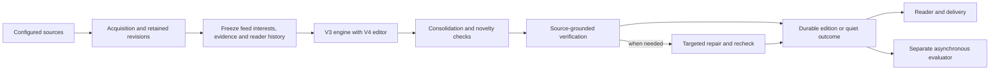

# Distilled.news

Distilled.news turns recurring streams of news into short, source-linked briefings about a reader's interests. The goal is to keep material facts, qualifications and updates visible without making readers scan every post or reread the same story.

[Live site](https://distilled.news) · [Documentation](docs/README.md) · [Course evaluation evidence](docs/AGENT_PERFORMANCE_EVALUATION.md)

## What readers can do

- Create multiple feeds with an interest description, schedule and language. New feeds default to public and have username-scoped URLs. Private feeds are accessible only to their owner.
- Configure Telegram, RSS, Google News, X or LinkedIn sources as supported by the deployment. Search retained published feeds, discover public feeds, and star feeds to follow them.
- Scan headlines, expand summaries, and open source evidence. Use unread catch-up and install the web app where supported. Device notifications require browser permission and configured delivery.
- Read localized editions in Arabic, English or French. Editorial and operational evidence varies by language and provider.

The Cloudflare production application uses the V3 briefing engine. The V4 editor is the default prompt policy for new V3 inputs. The separate continuous quality Worker and AgentOps collector have production deployment configurations. Connector and email availability depend on the environment; some acquisition routes require a private helper, a browser session or an Apify account. Published search is retained-feed search. The product has no chatbot or embedding search. [Production configuration](apps/worker/wrangler.production.jsonc) · [Operations](docs/README.md#deploy-and-operate)

## How a briefing is made



Language models handle editorial choices that depend on meaning: assessing relevance, combining compatible reports, writing a concise brief and verifying the resulting claims. The runtime owns deadlines, source and citation identity, permissions, evidence admission, spend accounting and durable recovery. A completed model call is an intermediate result; the edition must still satisfy publication rules. Source attribution and provenance checks improve auditability. They do not certify factual accuracy. [Current architecture](docs/ARCHITECTURE.md) · [Briefing engine](packages/briefing/src/engine.ts)

The workspace uses TypeScript, React and Vite for the reader, Hono on Cloudflare Workers for the API, D1 for application state, R2 for retained source payloads, and Queues and scheduled Workers for asynchronous work. The product configuration chooses model routing and mail transport. OpenRouter is configured for the V3 production editor and verifier; Cloudflare AI Gateway and other provider paths are available where configured.

## Run locally

Use Node.js 24 and the pinned pnpm 10.12.1. From the repository root:

```sh
pnpm install --frozen-lockfile
pnpm run setup
pnpm --filter @distilled/worker db:migrate
pnpm dev
```

In a second terminal, run `pnpm --filter @distilled/web dev` and open `http://127.0.0.1:5173`. The Vite dev server proxies API requests to the local Worker. The default setup generates local files; keep `.env` and `apps/worker/.dev.vars` private. Provider-dependent collection and inference require separately configured credentials. Local Windows development leaves browser containers disabled. See the [deployment guide](docs/production-deployment.md) and [web app guide](docs/WEB_APP_AND_NOTIFICATIONS.md) before configuring shared resources or notifications.

```sh
pnpm typecheck
pnpm test
pnpm build
python evaluation/briefing-quality/continuous.py
```

The workspace build uses a Wrangler dry run for the Worker. The continuous evaluation command runs offline fixtures and requires Python 3.11 or later. Its reports and historical failures are separate from live review records. [Runtime and test entry points](package.json) · [Project CI](.github/workflows/project-checks.yml) · [Offline evaluation instructions](evaluation/briefing-quality/README.md)

## Submission and engineering evidence

| Area | Start here |
| --- | --- |
| Problem, design alternatives and agentic justification | [Project problem and validation design](docs/planning/v1.5/PROJECT_PROBLEM_AND_VALIDATION_v1.5.md) · [Current architecture](docs/ARCHITECTURE.md) |
| Agent performance | [Course evidence index and sanitized appendix](docs/AGENT_PERFORMANCE_EVALUATION.md) · [Briefing evaluation suite](evaluation/briefing-quality/README.md) · [Recorded release qualification](evaluation/briefing-quality/reports/live-fixes-20261119/GO_RESULT.md) |
| AgentOps and professional engineering | [Observability and real publication pilot](docs/README.md#evaluation-and-evidence) · [k6 and performance fixtures](evaluation/performance-reliability/README.md) · [Security workflows and evidence](docs/security/DEVSECOPS.md) |
| Reliability, privacy and QA | [Source-bound claims](docs/SOURCE_BOUND_CLAIMS.md) · [Transactional recovery](docs/transactional-briefing-recovery-staging-2026-11-13.md) · [CI checks](.github/workflows/project-checks.yml) |
| Setup and reproducibility | [Documentation index](docs/README.md) · [Acquisition benchmark](evaluation/acquisition-benchmark/README.md) · [Monitor protocol and reporting](evaluation/briefing-quality/worker/README.md) |

The evaluation compares against all-headlines and keyword filtering, Single LLM, and specific prior pipeline versions. Monitored production editions, live comparison outputs, offline fixtures and automated judge labels answer different questions. The comparisons record strengths and failures. No general win over Single LLM, production-wide factual accuracy rate or measured reader time saving follows from the available cohorts. Experimental comparator and evaluator revisions remain research work. [Evaluation and uncertainty](docs/README.md#evaluation-and-evidence)
